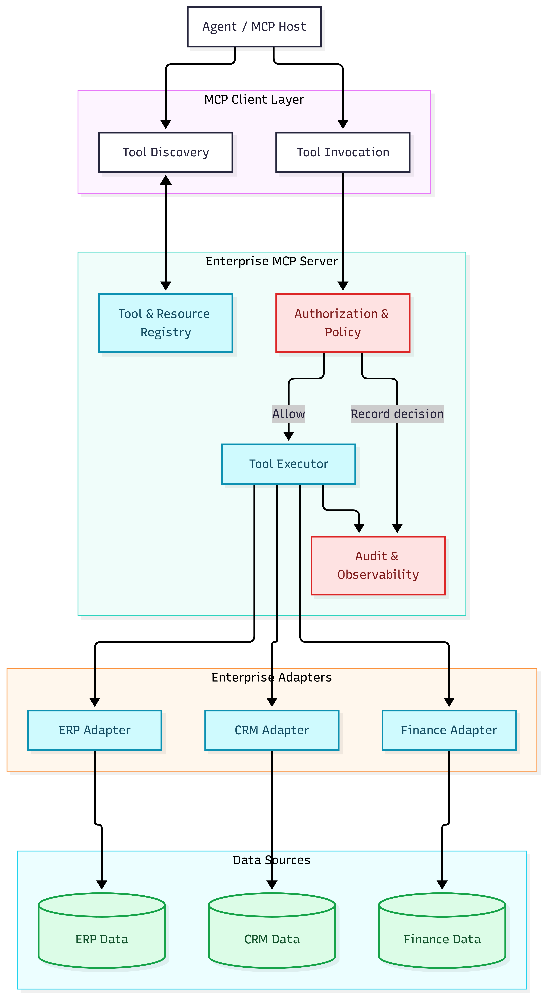
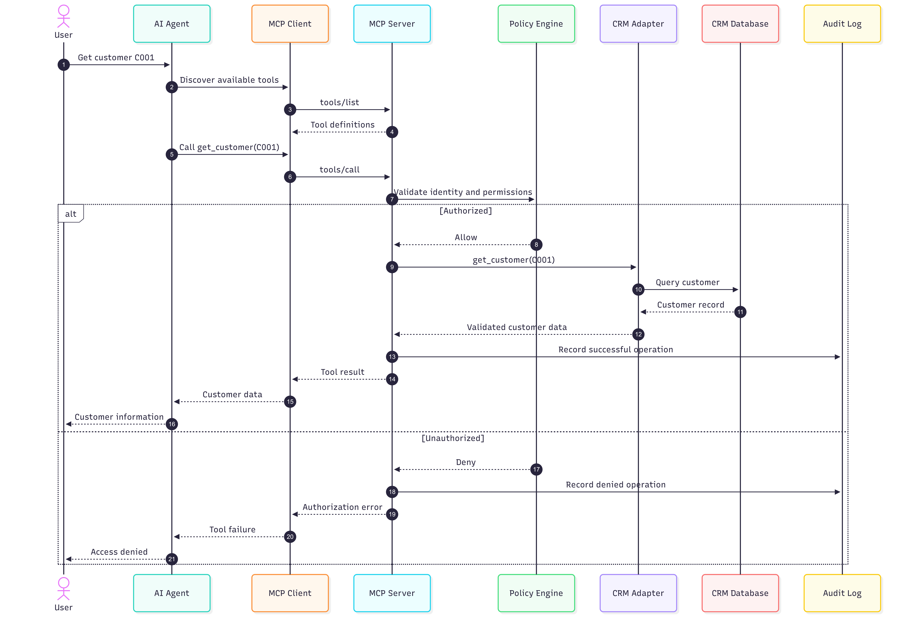
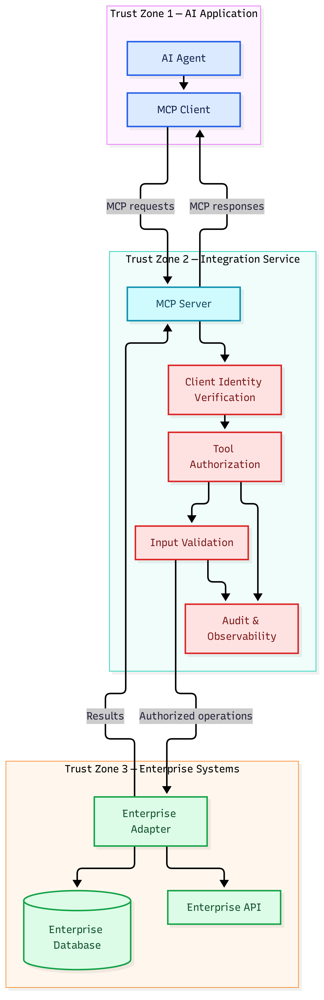

# AI-A04 — MCP & Enterprise Integration Architecture

**AI Architecture Portfolio | Project A04**

Designing and implementing a standards-based integration
architecture that enables AI agents to access enterprise
tools, data, and services through the Model Context
Protocol (MCP).

## Project Objective

Build a reusable enterprise integration foundation
that connects AI agents with enterprise capabilities
through standardized MCP interfaces.

## Relationship to the AI Architecture Series

| Project | Focus |
|---------|-------|
| AI-A01 | Enterprise AI Reference Architecture |
| AI-A02 | Agent Orchestration & A2A |
| AI-A03 | Enterprise RAG & Knowledge |
| AI-A04 | MCP & Enterprise Integration |

AI-A04 provides the integration boundary through which
AI applications can access enterprise capabilities.

Cross-project integration is planned, not yet implemented.

## Architecture

### System Context


### Container Architecture



### MCP Tool Invocation



### Security & Trust Boundaries



Mermaid source and SVG versions are included in diagrams/.

## Technology Stack

- Python 3.12
- Official MCP Python SDK v2
- MCP stdio transport
- Pydantic
- pytest
- Mermaid
- Git / GitHub

## Day 1 Implementation

The initial MCP server exposes:

### Tools

- get_customer
- list_customers

### Resources

- enterprise://catalog

The implementation uses synthetic in-memory customer data.

### Working Capabilities

- MCP tool discovery
- MCP tool invocation
- MCP resource discovery
- In-process client/server communication
- Independent-process communication over stdio
- Unit and integration tests

## Getting Started

Prerequisite: Python 3.12.

```bash
git clone https://github.com/cpgrant/a-04-mcp-enterprise-integration.git
cd a-04-mcp-enterprise-integration

python -m venv .venv
source .venv/bin/activate

python -m pip install -e ".[dev]"
```

### In-process demonstration

```bash
python -m src.client.demo
```

### Independent-process MCP demonstration

```bash
python -m src.client.stdio_demo
```

### Tests

```bash
python -m pytest tests/ -v
```

## Architecture Decision Records

The docs/adr directory contains decisions covering:

1. Official MCP Python SDK
2. Transport strategy
3. Enterprise adapter separation
4. Server-side authorization
5. Audit and observability

## Day 2 Roadmap

- ERP, CRM and finance adapters
- Database-backed enterprise data
- Structured tool results
- Server-side authorization
- Input validation
- Audit logging and error handling
- Expanded integration and security tests

## Future Integration

AI-A04 is intended to support:

- AI-A02 agent orchestration
- AI-A03 enterprise knowledge retrieval
- AI-A05 governance and policy enforcement
- Autonomous Enterprise business applications

## Status

**Day 1: MCP foundation implemented and tested.**

Four automated tests passed during Day 1 validation.

Enterprise adapters and governance controls are
planned for Day 2.

## Author

Christian Grant

DeepAIMind — https://deepaimind.com

---

## Day 2 — Enterprise Integration

Day 2 extends the MCP foundation with PostgreSQL-backed
CRM, ERP and Finance capabilities.

### Implementation highlights

- PostgreSQL 17 with three enterprise schemas
- Nine relational tables
- 715 synthetic business records
- CRM, ERP and Finance adapters
- Nine registered MCP tools
- Local role-based tool policy
- Read-only database account
- Structured audit events
- 26 passing automated tests

### Running the enterprise demonstration

Start PostgreSQL:

```bash
docker compose up -d
```

Install the project:

```bash
python -m pip install -e ".[dev]"
```

Provision and seed the database using the SQL scripts
in `database/` and the provisioning script in `scripts/`.

Run the cross-domain demo:

```bash
python -m src.client.enterprise_demo
```

Run the tests:

```bash
python -m pytest tests/ -v
```

See [Day 2 Implementation](docs/AI-A04-Day2-Implementation.md)
for architecture, security decisions and limitations.
